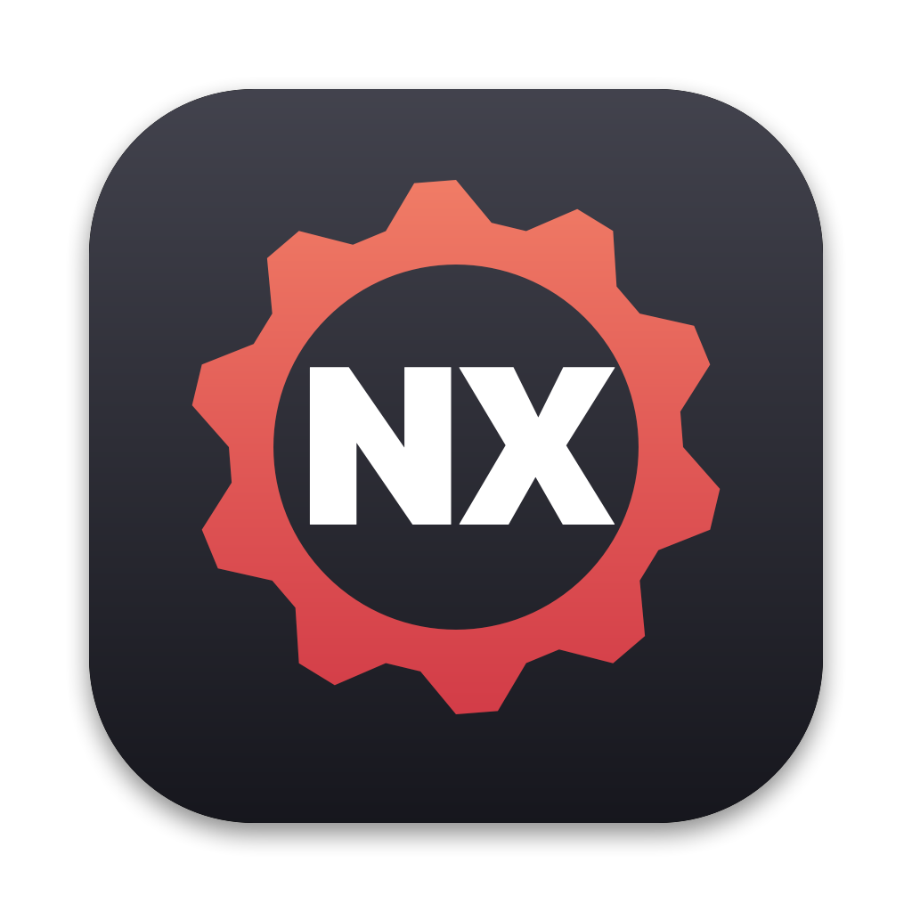
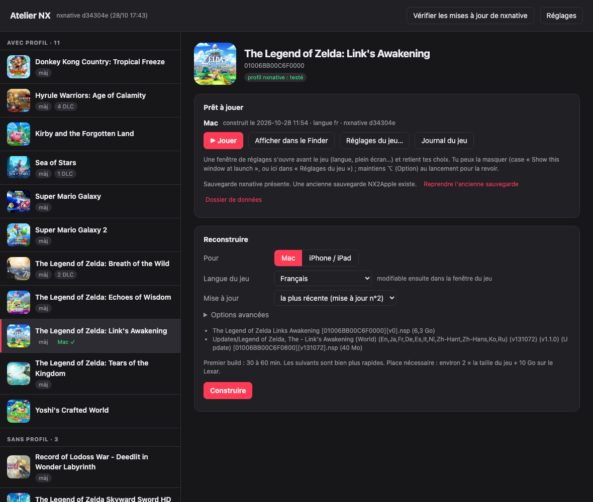

# Atelier NX

Interface graphique simple pour [nxnative](https://github.com/seedds/nxnative) (le projet d'origine), sans passer par NX2Apple : on choisit un jeu Switch, la langue, la mise à jour et les DLC, et on clique sur Construire.



- Liste les jeux Switch de tout le dossier, sous-dossiers compris, avec leurs mises à jour et DLC où qu'ils soient rangés. L'identifiant est lu dans le fichier (ticket du NSP, en-têtes NCA d'un XCI ou d'un NSP sans ticket, déchiffrés avec `prod.keys`), sinon dans le nom (`[title ID]`). Jeux groupés « avec profil » / « sans profil », jaquettes eShop, archives `.zip` décompressables.
- Construit une app Mac ou une IPA avec `scripts/build_ipa_from_nsp.py`, en choisissant la langue, la mise à jour et les DLC, avec la progression en direct (`--progress json`).
- File de construction : « Construire » ajoute le jeu à la file avec ses options (langue, mise à jour, DLC, options avancées) ; les builds s'enchaînent, un échec n'arrête pas la file. Ordre modifiable, pause, historique. La file est gardée sur disque (`queue.json`) : quitter pendant un build le remet en tête, file en pause.
- Builds en priorité basse (`nice -n 10`, réglable) : ils prennent le processeur libre sans faire ramer les autres apps.
- Bouton « Jouer », journal du jeu, reprise des anciennes sauvegardes NX2Apple.
- « Réglages du jeu » : les réglages de la fenêtre de lancement nxnative (liste lue dans `launcher.json`), pré-remplis via les choix enregistrés de l'app (`launcher.<VAR>`), sans les bloquer. Réglages par défaut appliqués automatiquement à chaque nouveau build Mac. `env.txt` reste accessible pour forcer un réglage.
- Vérifie et installe les mises à jour de nxnative (`git pull`), et signale les jeux construits avec une ancienne version.
- « Compatibles que tu n'as pas » : les jeux qui ont un profil nxnative et ne sont pas dans le dossier (branche distante lue par `git fetch` toutes les 6 h, variantes régionales fusionnées, « nouveau » pour les profils arrivés depuis la dernière mise à jour du clone). Un clic ouvre le profil sur GitHub.

## Fonctionnement

- `server.py` : serveur local (127.0.0.1, jeton par session) qui lance nxnative ; bibliothèque standard Python, plus pycryptodome (déjà requis par nxnative) pour lire les en-têtes NCA.
- `index.html` : la page.
- `App/main.swift` : la fenêtre Mac (WKWebView, interface sombre) qui démarre le serveur et le coupe en quittant ; réutilise un serveur déjà lancé (`server.json`).
- `App/icon/make_icon.swift` : dessine l'icône (`App/AppIcon.icns`).

Le script de nxnative attend un dossier par jeu : Atelier NX crée `nxnative-build.noindex/<title ID>/` (« .noindex » : Spotlight ignore ses milliers de fichiers) avec des liens symboliques vers les fichiers choisis. Le dossier `<title ID>_build` que nxnative y crée garde l'extraction pour les builds suivants. Les apps vont dans `Apps/`.

Réglages et état : `~/Library/Application Support/AtelierNX/` (`config.json`, `state.json`, `queue.json`, `catalog.json`, icônes). La variable `ATELIERNX_SUPPORT` permet d'utiliser un autre dossier (tests).

## Installation

1. Prérequis de nxnative : Mac Apple Silicon, Xcode 27.1 et sa chaîne Metal, Homebrew, et votre propre `prod.keys` (extrait de votre console).
   ```
   brew install xcodegen zstd glslang dotnet-sdk python@3.13
   ```
2. Cloner nxnative et lui créer un environnement Python (3.12 ou plus) :
   ```
   git clone https://github.com/seedds/nxnative ~/nxnative
   cd ~/nxnative
   /opt/homebrew/bin/python3.13 -m venv .venv
   .venv/bin/pip install lz4 capstone fonttools nsz pycryptodome
   ```
3. Télécharger Atelier NX dans les [releases](https://github.com/VGioM/AtelierNX/releases) (ou le compiler, voir plus bas) et le mettre dans Applications. L'app est signée ad hoc : au premier lancement, clic droit → Ouvrir.
4. Dans **Réglages**, choisir le dossier des jeux Switch (NSP/XCI, sous-dossiers compris) et `prod.keys`.

Valeurs par défaut : nxnative dans `~/nxnative`, Python = `~/nxnative/.venv/bin/python` (sinon le premier `python3.12+` de Homebrew), clés dans `~/.switch/prod.keys`. Les apps construites vont dans `<dossier des jeux>/Apps`, les fichiers de build dans `<dossier des jeux>/nxnative-build.noindex` (prévoir environ 2 × la taille du jeu + 10 Go) ; les deux se changent dans Réglages.

## Compiler

```
./build.sh            # dist/Atelier NX.app
./build.sh install    # et copie dans /Applications
```

Sans l'app : `python3 server.py --open` ouvre la page dans le navigateur.
